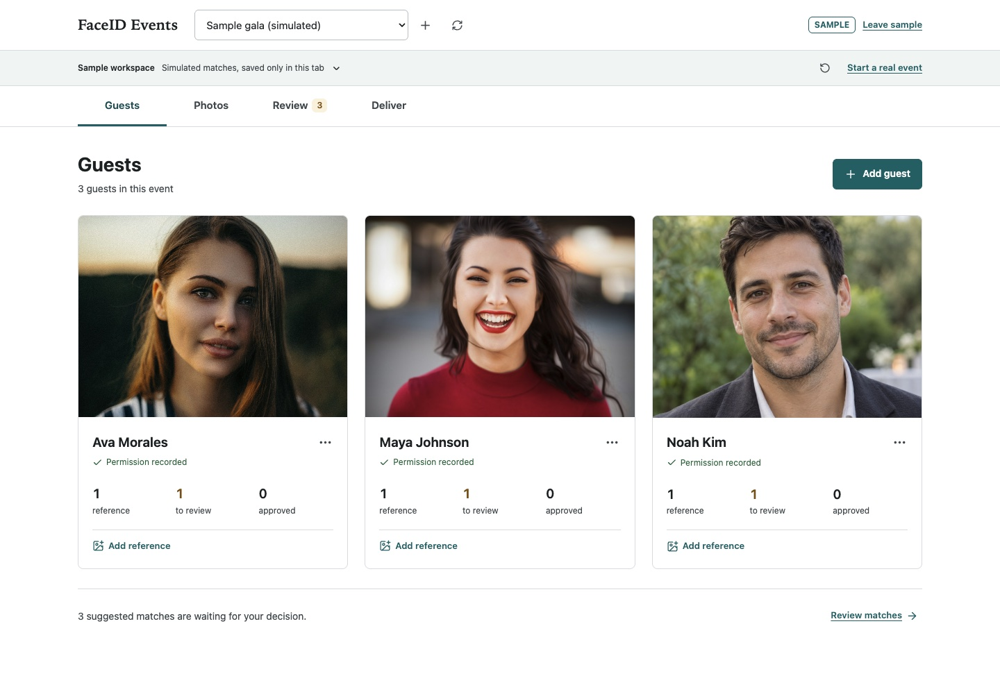

# FaceID

FaceID Events helps photographers sort private-event photos by consenting guest. Guests submit named references and permission through an event signup link, or hosts add references themselves. Hosts upload a shoot, review suggested face matches, and export approved guest-by-guest photo lists for their existing delivery process. A React frontend on Cloudflare Pages connects to a Cognito-authenticated AWS backend, with Terraform-managed S3, Lambda, DynamoDB and Rekognition.

**Live demo:** [https://faceid-8dc.pages.dev](https://faceid-8dc.pages.dev)

The public homepage explains the workflow. [Try the sample workspace](https://faceid-8dc.pages.dev/demo) without an account or AWS uploads; [sign in](https://faceid-8dc.pages.dev/app) to use real events. Frontend and Lambda code must be released together when the API contract changes.

## TLDR

FaceID helps event photographers find each consenting guest's photos, review possible matches, and export a guest-by-guest delivery list. The public homepage explains the offer; an explicit sample workspace demonstrates the workflow without sending photos to AWS. The real workspace uses Cognito, private S3, Lambda, DynamoDB and Rekognition, managed with Terraform.

## About

This project demonstrates a pragmatic path from an interactive frontend prototype to a deployable serverless image-processing system for private event photo delivery. The UI is usable without a backend for review/demo purposes, while the AWS backend is defined in Terraform so the infrastructure can be created and destroyed repeatably.

## Screenshots

Captured from the local production build. Sample names, photos and matching scores are illustrative, not recognition benchmarks or customer evidence.

[Sales Homepage](docs/screenshots/landing.jpg) · [Guest Workspace](docs/screenshots/workspace.jpg) · [Review Desk](docs/screenshots/review.jpg)



## Tech Stack

- **Frontend:** React 19, TypeScript, Vite
- **UI:** Responsive CSS with design tokens in `src/styles.css`, `lucide-react` icons
- **Hosting:** Cloudflare Pages, Wrangler
- **Backend:** AWS API Gateway HTTP API, Cognito Hosted UI/JWT authorizer, Python 3.12 Lambda
- **Storage:** Private S3 bucket with presigned PUT and GET URLs
- **Face matching:** Amazon Rekognition `IndexFaces` for references and bounded `CompareFaces` checks for uploaded photos
- **Database:** DynamoDB tables for events, people, photos, matches, and short-lived upload sessions
- **Infrastructure:** Terraform with cost guardrails for throttling, batch size, and upload limits
- **Quality:** Vitest, Python `unittest`, GitHub Actions CI, Terraform validation

## Engineering Highlights

- Direct browser-to-S3 uploads through presigned URLs, avoiding API Gateway payload limits for image files.
- Explicit runtime separation: `/demo` simulates locally; `/app` requires both API and Cognito configuration. Missing configuration never opens an unauthenticated live workspace.
- Cognito sign-in with API Gateway JWT authorization and owner-scoped S3/DynamoDB records.
- Event/workspace data model that scopes people, photos, matches, and uploads to a selected private event.
- Consent-attested reference intake records source/time for host uploads and guest-submitted signups. Event-scoped guest capabilities allow reference intake without exposing the owner's library.
- Human-in-the-loop review workflow for match candidates: `matched`, `needs_review`, `approved`, and `rejected`.
- Named reference intake preserves operator-entered names, uses distinct identifiers for same-name guests, and binds references to verified upload sessions.
- Approved-only delivery lists contain durable guest/photo identifiers and filenames, with spreadsheet formula protection and no signed URLs.
- DynamoDB-backed upload sessions that verify issued S3 keys, object size, content type, and upload metadata before processing.
- Owner-scoped delete flows for removing uploaded photos and reference/person records from S3, DynamoDB, and Rekognition.
- Portrait-led Guests, Photos, Review and Deliver views, focused intake dialogs, a side-by-side review desk, corrected decisions, and per-file partial/error states.
- Focused frontend and backend tests for API upload contracts, auth context, and upload validation.
- GitHub Actions CI for linting, tests, frontend build, Lambda syntax, and Terraform validation.
- Structured Lambda logs, API Gateway access logs, CloudWatch alarms, and optional AWS Budget alerts.
- Named intake needs no file renaming. The API retains legacy filename-based intake for compatibility.
- Matching-quality guidance for choosing the two reference images when different poses or poor lighting are expected.
- Private photo storage with short-lived signed preview URLs rather than public S3 objects.
- Explicit low-volume cost controls: max files per batch, upload size limits, bounded people/reference comparisons, API throttling, and short CloudWatch log retention.
- Terraform-managed backend resources with `terraform destroy` support for cleanup.
- Clear match states for responsible review: `matched`, `needs_review`, `approved`, `rejected`, and `unknown` in the shared API types.

## Architecture

The system is documented in:

- [Architecture Overview](docs/architecture.md)
- [Backend API Contract](docs/backend-api.md)
- [Responsible Use And Matching Quality](docs/responsible-use.md)
- [Architecture Decision Records](docs/adrs/README.md)
- [Terraform Deployment Notes](infra/terraform/README.md)
- [Joint Product Review And Acceptance Criteria](docs/product-experience.md)
- [Media Sources](docs/media.md)

At a high level:

```text
Browser -> Cloudflare Pages React app -> Cognito + AWS API Gateway -> Lambda
                                                    |-> S3
                                                    |-> Rekognition
                                                    |-> DynamoDB
```

## Local Development

```bash
npm ci
npm run dev
```

Open the URL printed by Vite. The homepage is public; `/demo` opens a clearly labeled, simulated sample workspace. Sample data is temporary and is not uploaded to AWS, including when production API configuration is present.

For the real workspace, copy `.env.example` to `.env.local` and populate all three AWS/Cognito values from Terraform outputs. Add the exact frontend origin and callback URL to Terraform's CORS, callback and logout variables. Restart Vite after changing environment variables. `VITE_` values are public configuration, never credentials.

## First Event

1. Sign in and create an event.
2. In Guests, choose **Invite guests** and copy the signup link. Share it only with invited guests. They submit a name, one or two clear JPEG/PNG face photos and permission without an account. Or choose **Add manually** and confirm their permission. No filename renaming is required.
3. In Photos, choose **Upload photos** to select or drop event photos. References must be ready first; adding references later does not automatically rematch older photos.
4. In Review, inspect the whole image and reference photo, approve or reject candidates, and correct decisions when needed.
5. In Deliver, export confirmed guest/photo rows or copy filenames into the existing gallery delivery workflow. Unreviewed and rejected suggestions are excluded. This is a file list, not a hosted guest gallery.

The frontend accepts JPEG/PNG up to 15 MiB each, processes event photos in small sequential requests, and reports partial progress. The default matching guardrails are 50 guests and two reference photos per guest. The API rejects events above its guest limit instead of silently skipping guests. Processing remains synchronous and is intended for small evaluations, not a large event ingestion service.

## Validation

```bash
npm run lint
npm test
npm run build
python3 -m py_compile backend/lambda/app.py
terraform -chdir=infra/terraform fmt -check
terraform -chdir=infra/terraform validate
git diff --check
```

## Cloudflare Pages

- Framework preset: `Vite`
- Build command: `npm run build`
- Build output directory: `dist`
- Node version: `22`

Set these Cloudflare Pages environment variables after the AWS API is deployed:

```text
VITE_API_BASE_URL=<api_base_url>
VITE_AUTH_CLIENT_ID=<cognito_web_client_id>
VITE_AUTH_DOMAIN=<cognito_hosted_ui_domain>
```

## AWS Backend

Terraform lives in `infra/terraform` and creates a new serverless backend. For the existing production deployment, recover the original Terraform state or import its resources before applying or destroying anything; this release checkout does not contain that state. Code-only releases preserve the current Lambda environment and guest signing secret. See the [deployment precautions](infra/terraform/README.md).

For a new stack:

```bash
cd infra/terraform
terraform init
terraform apply
```

Destroy everything, including uploaded photos:

```bash
cd infra/terraform
terraform destroy
```

See [infra/terraform/README.md](infra/terraform/README.md) for variables, cost guardrails, and Cloudflare CORS setup.

## Privacy And Security Notes

- Uploaded photos are stored in a private S3 bucket.
- The frontend receives short-lived signed URLs for uploads and previews.
- Cognito protects API routes with JWT authorization.
- Lambda scopes S3 keys and DynamoDB reads/writes to the authenticated Cognito user.
- Upload processing requires a valid upload session and verifies the S3 object before invoking Rekognition.
- Host-added references require owner-attested consent; the guest portal requires guest-submitted permission. These are consent records, not verified identity or legal-compliance guarantees.
- Users can remove their uploaded photos and reference/person records; deletes remove private S3 objects and related metadata.
- Face matching is probabilistic; every suggestion needs approval before it appears in the exported delivery list, regardless of score.
- Upload sessions are marked `processed` or `failed` so partial processing failures are visible in backend state.
- Live AWS mode uses conservative API throttles and upload limits; sample mode never invokes AWS.
- `force_destroy_bucket` defaults to `true` in Terraform so teardown removes uploaded assets.

## Limitations

- The MVP backend uses bounded `CompareFaces` checks against stored reference images; this is simple and deployable, but cost grows with `photos * people * references`.
- Different face angles and poor image quality can reduce match confidence. Use two clear references when poses differ, and review the results. The default limit is two references per guest, not an unlimited reference database.
- The current Lambda does not crop every face in group photos before searching. Large group-photo support would require a deeper face-detection/cropping pipeline.
- No moderation, hosted gallery sharing, role-based staff workflow, or retention scheduler is included.
- Guest signup links are bearer capabilities for references only. They do not automatically expire and have no per-event revocation control; share them only with invited guests. Guests ask the host to remove references or withdraw permission.
- CSV export helps prepare a delivery list; it does not publish galleries, download original photo bundles, or collect payments.
- Large events still need durable background processing, thumbnail generation and paginated library queries. Client progress and retries do not remove server timeout risks.
- Correctional surveillance, public-space tracking, inmate tracking, and other law-enforcement identification workflows are explicitly non-target use cases for this project.
- Reference images are managed at the person level in the current UI rather than as individually editable reference assets.
- The current frontend does not refresh Cognito tokens in place; users sign in again after the token expires.
- CI validates infrastructure and app code, but deployment is still intentionally manual.
- The Cloudflare Pages deployment is static; backend environment wiring happens through `VITE_API_BASE_URL`, `VITE_AUTH_CLIENT_ID`, and `VITE_AUTH_DOMAIN`.

## Project Structure

```text
backend/lambda/        Python Lambda API
.github/workflows/     CI validation workflow
docs/                  API, architecture, and ADR documentation
infra/terraform/       AWS serverless infrastructure
public/                Cloudflare Pages headers and redirects
src/                   React frontend
```
