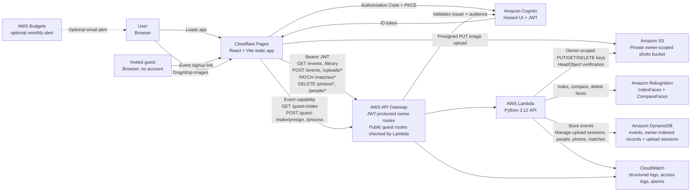

# Architecture

FaceID is split into a static frontend and an AWS serverless backend. The public homepage and explicit `/demo` sample work independently of the backend; sample uploads and decisions stay in browser memory. The real `/app` workspace requires both API and Cognito configuration. Signed-in users create events, upload consent-attested guest references and event photos directly to S3, and record human review decisions for face-match candidates. Lambda verifies upload sessions and S3 object metadata, then coordinates Rekognition and DynamoDB updates for the authenticated user and selected event.

## C4-Style Container Diagram

## Runtime Flow

1. The browser loads the React app from Cloudflare Pages.
2. The public homepage explains the workflow. `/demo` uses explicit sample data and simulated matching, regardless of AWS configuration.
3. For the real workspace, all API/Cognito variables are required and unsigned users authenticate through Cognito Hosted UI with Authorization Code + PKCE.
4. The frontend sends the Cognito ID token as a bearer token to API Gateway.
5. API Gateway validates the JWT issuer and audience before invoking Lambda.
6. Lambda derives the owner from the Cognito `sub` claim.
7. The frontend loads or creates private event workspaces through `/events`.
8. The frontend loads `/library?eventId=<event-id>` for the selected workspace.
9. For uploads, the frontend calls `/uploads/presign` with event ID, mode, and file metadata.
10. Lambda creates short-lived event-scoped upload sessions in DynamoDB, binding an explicit guest name and identifier for named reference intake.
11. Lambda returns upload session IDs and presigned S3 PUT URLs under `users/<owner>/events/<event>/<mode>/...`.
12. The browser uploads image bytes directly to the private S3 bucket with signed upload metadata.
13. The frontend calls `/uploads/process` with the uploaded S3 keys, upload session IDs, and consent confirmation for reference uploads.
14. Lambda verifies the upload session, S3 object size, content type, and S3 metadata before processing.
15. Reference uploads are indexed with Rekognition `IndexFaces` and saved as event-scoped people records with consent metadata.
16. Photo uploads are compared against bounded reference images in the selected event with Rekognition `CompareFaces`.
17. Lambda writes owner/event-scoped photo and match metadata to DynamoDB and returns preview URLs and match states.
18. Reviewers approve or reject match candidates through `PATCH /matches/{photoId}/{personId}` and can change decisions through that same route. The browser exports approved-only filename/identifier lists without signed URLs.
19. For photo deletes, Lambda verifies ownership, removes the S3 object, deletes photo and match rows, and decrements affected people counters.
20. For person deletes, Lambda verifies ownership, removes reference S3 objects, deletes Rekognition face IDs, deletes related match rows, and decrements affected photo counters.
21. Lambda emits structured request logs; API Gateway emits JSON access logs.
22. CloudWatch alarms track Lambda errors, Lambda throttles, and API 5xx responses.

Guest signup is a separate path: an authenticated owner obtains `/events/{event_id}/intake-link`. Its `/guest?eventId=...&token=...` URL contains an HMAC capability scoped to that event. Public guest routes validate the capability and return only the event name/ID; they never expose the owner's library. Guest uploads are references only, with names bound to upload sessions and consent recorded as `guest_submitted`. The host's review/delivery flow remains JWT-protected.

## Deployment Shape

- **Frontend:** Cloudflare Pages serves the Vite build output from `dist`.
- **Backend:** Terraform creates Cognito, API Gateway JWT authorization, Lambda, S3, DynamoDB tables for events/people/photos/matches/upload sessions, Rekognition collection, IAM policy, CloudWatch logs, alarms, and optional budget alerts.
- **Configuration:** Cloudflare Pages needs `VITE_API_BASE_URL`, `VITE_AUTH_CLIENT_ID`, and `VITE_AUTH_DOMAIN` from Terraform outputs for AWS mode.
- **CI:** GitHub Actions runs linting, tests, frontend build, Lambda syntax checks, Terraform formatting, and Terraform validation.
- **Teardown:** `terraform destroy` removes the backend resources. The S3 bucket defaults to `force_destroy_bucket = true` for prototype cleanup.

## Key Constraints

- The hosted demo can operate without AWS by using mock data.
- Owner API routes require a Cognito JWT. The three guest routes have no JWT authorizer and instead verify an event-specific HMAC capability in Lambda.
- The application scopes records by Cognito `sub` and event ID, but it does not include a full account-management or retention workflow.
- Uploaded photos can be deleted individually; reference images are currently managed by deleting the person/reference record.
- Delete flows clean up S3 objects and DynamoDB metadata, but they are not wrapped in a multi-service transaction.
- Match review decisions are stored on match records; there is no separate immutable audit table yet.
- Upload session records are short-lived and protected by DynamoDB TTL, but TTL cleanup is eventually consistent.
- CloudWatch alarms are lightweight and low-volume oriented; incident response is limited to optional email notifications.
- The frontend stores short-lived tokens in session storage and does not currently perform silent refresh.
- Uploads are capped by Lambda-configured file count and file size guardrails.
- Named reference intake uses opaque identifiers, preserves display names, and returns the latest complete guest snapshot; clients must not add cumulative reference counts together.
- Unusable no-face reference images are removed and return warnings. Other failed/abandoned upload cleanup still needs a comprehensive retention job.
- Event photo processing remains synchronous. Small client requests and partial-result UI improve feedback but do not provide durable background processing or guarantee completion under service timeouts.
- Matching cost grows with `uploaded photos * compared people * reference images per person`.
- More reference images per guest can improve matching across side angles and candid shots, but increases Rekognition comparison calls.
- The current MVP does not crop every detected face in group photos before matching.
- S3 objects remain private; browser access uses short-lived signed URLs.
- Guest capabilities currently have no automatic expiry or per-event revocation. Rotating the server signing secret invalidates every existing link; it stays server-side and must be preserved when recovering a deployment.
- The current delivery output is a browser-generated approved-only CSV/filename list. Hosted client galleries, guest-side deletion and payments are not implemented.
- Public-space tracking, correctional surveillance, inmate tracking, and automated law-enforcement identification are non-target use cases for this architecture.
